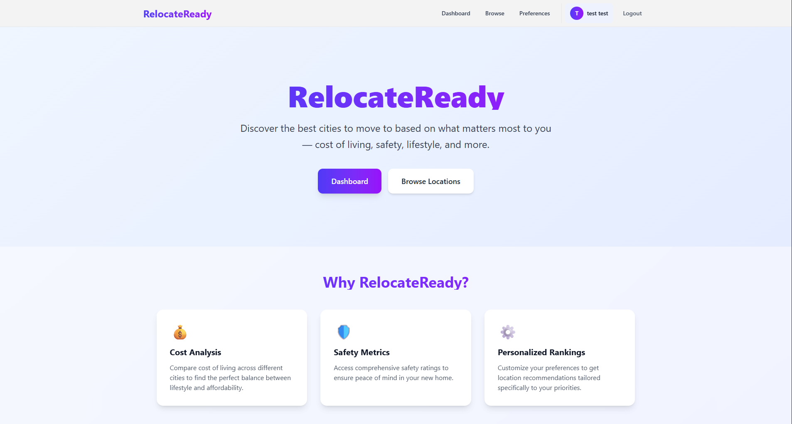
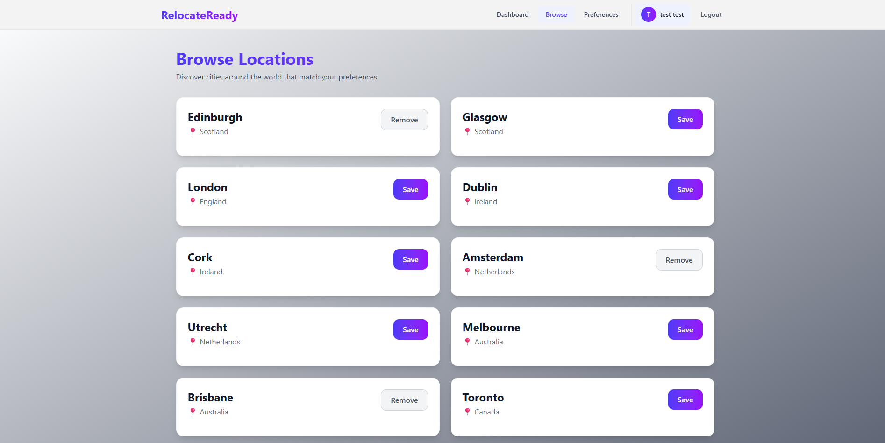
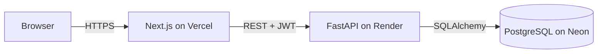

# RelocateReady API

RelocateReady helps people compare cities they're considering moving to. Users weight what matters most to them (cost of living, safety, climate, healthcare), save the cities they're interested in, and get a personalized ranking.

This repository is the **backend**: a FastAPI service with JWT authentication, PostgreSQL, and versioned database migrations.

**Live demo:** https://relocate-ready.vercel.app  ·  **API docs:** https://relocateready-api.onrender.com/docs  ·  **Frontend repo:** https://github.com/Jonathan-Jordan22/RelocateReady-Frontend

> The API runs on free-tier hosting. If it has been idle, the first request can take up to a minute while the server wakes up.






## Highlights

- **Found and fixed a Broken Access Control vulnerability (IDOR)** by redesigning authentication around signed JWTs and owner-scoped queries ([details below](#security))
- **PostgreSQL with Alembic migrations**: schema changes are versioned, reviewable, and applied automatically on every deploy
- **Database-enforced integrity**: unique and NOT NULL constraints back up application checks and prevent race conditions
- **Transactional signup**: a user and their default preferences are created atomically, so a failed signup never leaves partial data
- **Environment-based configuration**: no secrets in source control, with separate signing keys for development and production

## Security

An earlier version of the app identified users by an ID stored in the browser, and every endpoint trusted that ID. Changing a single number in localStorage gave full access to another user's account, including the ability to edit or delete it. This is an **IDOR (Insecure Direct Object Reference)**, part of OWASP's #1 risk category, Broken Access Control.

I reproduced the issue with two test accounts, then redesigned authentication:

- **JWT bearer tokens** issued at login and signup, signed with HS256. The server accepts only its expected algorithm, which blocks `alg: none` forgery, and tokens expire after 60 minutes.
- **`/me` endpoints**: a `get_current_user` dependency verifies the token and loads the user. No endpoint accepts a user ID from the client, and every query on user data is filtered by the authenticated user's ID, so one user can never read or modify another's records.
- **bcrypt password hashing**, and the same error message for an unknown email as for a wrong password, which prevents account enumeration.
- **Fail-fast configuration**: the app refuses to start if the JWT signing key is missing, rather than running with weakened security.
- **Secrets live only in environment variables**, never in code or Git history.

**Known trade-off:** the frontend stores the token in localStorage, which JavaScript can read if an XSS vulnerability were ever introduced. Moving to httpOnly cookies would close that gap and is on the [roadmap](#roadmap).

## Architecture



- **Frontend:** Next.js (App Router) on Vercel. The API base URL comes from an environment variable.
- **Backend:** FastAPI on Render. Each deploy runs `alembic upgrade head` before starting the server, so the database schema always matches the deployed code.
- **Database:** managed PostgreSQL on Neon.
- **Monitoring:** an uptime monitor pings the health-check endpoint, which keeps the free-tier server warm and sends an alert if the API goes down.

## How Scoring Works

Each city has four indices (cost of living, safety, climate, healthcare), and each user has an importance weight for each one. A city's score is the **weighted average** of its indices using the user's weights, so a user who cares mostly about safety sees safe cities ranked highest. For cost of living, lower cost scores better.

## Tech Stack

| Area | Technology |
|---|---|
| Framework | FastAPI, Pydantic v2 |
| Database | PostgreSQL (Neon), SQLAlchemy ORM, psycopg 3 |
| Migrations | Alembic |
| Auth | PyJWT (HS256), bcrypt |
| Hosting | Render (API), Vercel (frontend) |
| Language | Python 3.14 |

## API Endpoints

🔒 = requires an `Authorization: Bearer <token>` header. Full interactive docs are available at `/docs`.

### Auth & Users
| Method | Endpoint | Description |
|---|---|---|
| POST | `/users/` | Sign up. Returns an access token |
| POST | `/users/login` | Log in. Returns an access token |
| GET | `/users/me` 🔒 | Get your profile |
| PUT / PATCH | `/users/me` 🔒 | Update your name or email |
| DELETE | `/users/me` 🔒 | Delete your account |

### Locations
| Method | Endpoint | Description |
|---|---|---|
| GET | `/locations/` | List all cities |
| GET | `/locations/countries` | List all countries |
| POST | `/locations/` | Add a city (admin-only access planned, see roadmap) |

### Preferences
| Method | Endpoint | Description |
|---|---|---|
| GET | `/preferences/me` 🔒 | Get your importance weights |
| POST | `/preferences/me` 🔒 | Create or update your weights |

### Saved Locations
| Method | Endpoint | Description |
|---|---|---|
| GET | `/user-locations/me` 🔒 | List your saved cities |
| POST | `/user-locations/me/{location_id}` 🔒 | Save a city |
| DELETE | `/user-locations/me/{location_id}` 🔒 | Remove a saved city |

### Scoring
| Method | Endpoint | Description |
|---|---|---|
| POST | `/score/` | Rank all cities by weights sent in the request (no account needed) |
| GET | `/score/me/{location_id}` 🔒 | Score one city against your preferences |
| POST | `/score/me/ranked` 🔒 | Your saved cities, ranked by score |
| GET | `/score/me/ai-suggest` 🔒 | Your top N matches across all cities |

## Running Locally

**Prerequisites:** Python 3.13+ and a PostgreSQL database. A free [Neon](https://neon.com) project works well. If `DATABASE_URL` is unset, the app falls back to a local SQLite file.

```bash
# 1. Clone and enter the project
git clone https://github.com/Jonathan-Jordan22/RelocateReady.git
cd RelocateReady

# 2. Create and activate a virtual environment
python -m venv .venv
.venv\Scripts\Activate.ps1      # Windows (PowerShell)
source .venv/bin/activate       # macOS / Linux

# 3. Install dependencies
pip install -r requirements.txt

# 4. Configure environment variables
cp .env.example .env            # then fill in the values

# 5. Create the database schema and seed the city data
alembic upgrade head
python -m app.seed_locations

# 6. Start the server
uvicorn app.main:app --reload
```

The API runs at `http://127.0.0.1:8000`, with interactive docs at `/docs`. To call protected endpoints from the docs page, log in with `POST /users/login`, copy the `access_token`, and paste it into the **Authorize** dialog.

### Environment Variables

| Variable | Required | Description |
|---|---|---|
| `DATABASE_URL` | Recommended | PostgreSQL connection string (`postgresql+psycopg://...`). Falls back to local SQLite if unset. |
| `JWT_SECRET_KEY` | Yes | Secret used to sign tokens. Generate one with `python -c "import secrets; print(secrets.token_urlsafe(64))"` |

### Database Migrations

```bash
# After changing a model, generate a migration and review the generated file
alembic revision --autogenerate -m "describe the change"

# Apply all pending migrations
alembic upgrade head

# Roll back the most recent migration
alembic downgrade -1
```

## Project Structure

```
RelocateReady/
├── alembic/
│   ├── versions/        # Migration scripts, applied in order
│   └── env.py           # Connects Alembic to the app's models and DATABASE_URL
├── app/
│   ├── models/          # SQLAlchemy models (tables)
│   ├── routes/          # API endpoints, grouped by resource
│   ├── schemas/         # Pydantic request/response models
│   ├── services/        # Scoring logic
│   ├── utils/           # Password hashing
│   ├── auth.py          # JWT creation and settings
│   ├── dependencies.py  # get_db and get_current_user
│   ├── database.py      # Engine and session configuration
│   ├── seed_locations.py
│   └── main.py          # App setup: CORS and routers
├── docs/                # README images
├── .env.example
├── alembic.ini
└── requirements.txt
```

## Roadmap

- [ ] Automated tests (pytest) and CI with GitHub Actions
- [ ] Admin role for managing city data (`POST /locations/`)
- [ ] httpOnly cookie authentication to replace localStorage tokens
- [ ] Refresh tokens for longer sessions without long-lived access tokens
- [ ] More city data and additional factors (job market, language, visa requirements)

## Author

**Jonathan Jordan**, B.S. Secure Software Development
GitHub: [@Jonathan-Jordan22](https://github.com/Jonathan-Jordan22)
